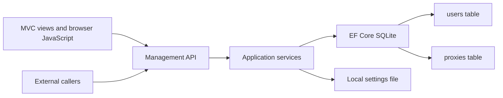

# Architecture

## Application

One ASP.NET Core MVC application targets `net10.0`. Razor views render the page shell; a small JavaScript module calls the JSON management API for reads and changes. External callers use the same endpoints. The earlier Blazor scaffold and Blazor skill have been removed.

| Location | Responsibility |
| --- | --- |
| `Controllers/` | Render MVC pages and choose the login view |
| `Views/` | Shared layout, home, settings, proxy list, and login |
| `wwwroot/js/app.js` | Browser API calls, forms, search, and proxy dialog |
| `Api/Controllers/` | HTTP routes and response status codes |
| `Api/Contracts/` | Explicit request/response DTOs; no password hashes in responses |
| `Api/Documentation/` | Read-only API reference view models derived from MVC metadata and DTO validation |
| `Services/` | Proxy operations, authentication operations, and atomic settings-file updates |
| `Security/` | Optional-auth authorization and cookie/session validation |
| `Models/` | `BaseModel`, `User`, and `Proxy` |
| `Data/` | EF DbContext and startup initialization |
| `Configuration/` | Settings defaults and storage paths |
| `Styles/app.css` | Tailwind v4 input with view/JavaScript sources |
| `Build/Tailwind.targets` | Optional one-shot standalone Tailwind compilation through dotnet/MSBuild |

The project has no Node/npm toolchain or CSS watcher. `dotnet build -t:BuildCss --no-restore` explicitly downloads and verifies the official standalone Tailwind **4.3.3** compiler on first use, then builds `wwwroot/app.css`. The local `.tools/` cache is excluded from source control and publish items. Ordinary build/run uses the included CSS without downloading the compiler. JavaScript in `wwwroot/js` runs only in the browser.

EF Core SQLite **10.0.12** is the only direct NuGet dependency. Its transitive packages implement persistence; MVC, API documentation metadata, authentication, and networking use the .NET shared framework.

## Storage and startup

The Debian 13 installer and Docker deployments are described in [installation](INSTALLATION.md). The curl-to-bash installer downloads `DragoQC/ProxyCraftPlus` from public GitHub, defaulting to `main`; no local checkout or repository-selection option is required. Both deployments use `/var/lib/proxycraftplus` for persistent data, configure an HTTP dashboard on port 8080, and preserve the default Minecraft port 25565. The optional `DataProtection:KeysDirectory` setting keeps cookie keys in that data directory with a stable application name; deployments set `Http:RedirectToHttps=false` while retaining production error handling. Other runs keep their previous defaults.

The default data directory is `App_Data`, configurable through `Storage:Directory`. It is excluded from version control and outside `wwwroot`.

`DatabaseInitializer` runs before accepting HTTP requests. It initializes settings, then invokes EF Core's `EnsureCreatedAsync`. Missing databases are created automatically; ordinary restarts retain rows. Only the specifically approved missing tables and nullable user 2FA columns are added to older Plus installations. There is no general migration or destructive schema update.

The app tables are `users`, `proxies`, `api_keys`, and `connection_events`. IDs belong to these derived models. `BaseModel` contains exactly three properties: `CreatedAt`, nullable `ModifiedAt`, and `IsActive`, mapped to `created_at`, `modified_at`, and `is_active`. The DbContext sets UTC creation and modification timestamps on async saves.

App settings use `settings.json`, avoiding an extra settings table. If the database was freshly created after deletion, the initializer clears any saved authentication-enabled flag, allowing a new main account to be created. Deleting a database is a manual testing/reset operation performed while stopped; the app never deletes one itself.

The user explicitly requested the new `api_keys` and `connection_events` tables. Startup uses narrow, idempotent `CREATE TABLE IF NOT EXISTS` statements because `EnsureCreatedAsync` does not add missing tables to an existing database. This preserves existing users/routes and never alters their schemas. API-key `Id = 1` is enforced by a database check constraint, so only one API-key row can exist. General migrations still require approval.

`ConnectionEventService` saves the client-supplied player name and requested domain snapshot, linked to the proxy by a required foreign key. Each insert and pruning of rows older than the latest 20 for that proxy share an immediate SQLite write transaction. Concurrent attempts cannot leave more than 20 committed rows per proxy. Deleting the parent proxy cascades to its events in the database; editing preserves history. The read-only `/api/v1/proxies/{id}/events` endpoint follows normal session/API-key rules, and a history button in the proxy list opens a dialog that polls it every 5 seconds while visible.

Live sessions are separate, immutable in-memory records owned by `MinecraftProxyService`, keyed by the accepted connection's unique ID. Once the named login packet has been written to an open backend, registration checks the route generation under the same lock used for route replacement. Cancellation removes the entry immediately; a `finally` block covers normal closure and errors. Multiple sessions with one player name remain independent. Status pings, pending logins, and failed backends never register. Restarting discards live state, while saved history remains unchanged. No database schema or stored event type is added.

`ProxyService` checks the requested proxy exists, then maps a runtime snapshot to `LiveConnectionResponse`. GET `/api/v1/proxies/{id}/connections` uses the normal management authorization and `no-store` policy. The proxy list's monitor/activity button reuses the existing history dialog with a live mode, including loading/empty/error states, cancellation of stale requests, and a 2-second visible-tab refresh. The history button retains its 5-second polling. Both lists describe proxy-observed connections and client-supplied names; neither confirms authentication or a completed Minecraft login. Silent link failures are removed only once network I/O detects them.

The shared connection dialog uses a flex column constrained to the dynamic viewport. Only the focusable list scrolls; the heading, count, and Close button stay visible. Unchanged snapshots skip rendering. Changed snapshots are built in a document fragment and applied together, restoring the first visible entry's offset if it still exists. Both 100 live connections and the 20 saved events use this path. No pagination, connection cap, database change, or new API contract is introduced. See [capacity checks and planning](CAPACITY.md).

Configured proxies keep one set of table rows and action handlers. Below 768px those rows become separate cards, destinations gain visible labels, domains/addresses wrap, and action buttons grow to 44px. The shared header hides the brand text and theme labels below 640px; accessible names remain on the logo link and theme buttons. Theme colors continue to use the existing shared tokens. Responsive utilities follow the installed Tailwind v4 [breakpoints](https://tailwindcss.com/docs/responsive-design) and [overflow behavior](https://tailwindcss.com/docs/overflow).

Each `ProxyResponse` includes `liveConnectionCount` from the existing in-memory session registry. The list builds all counts with one pass under the runtime lock, rather than sorting sessions or issuing separate per-proxy requests. Both desktop rows and mobile cards update their number during the existing 5-second polling without rebuilding rows or interrupting focused controls.

App Settings uses CSS columns: two at desktop widths (1024px and above), one below. Cards keep their natural heights and cannot split across columns, including expanded account forms. This masonry-style layout uses Tailwind's [columns](https://tailwindcss.com/docs/columns) and [break-inside](https://tailwindcss.com/docs/break-inside) utilities, with no script or layout dependency. Settings continue to live in `settings.json`.

## Optional authentication

A fresh setup works without login. Enabling authentication in App Settings creates or replaces the single main `User` (ID 1) from one username OR email and a password, then returns to the login page. Setup does not sign the user in.

ASP.NET Core cookies authenticate sessions; `PasswordHasher<User>` stores salted password hashes. Security-stamp and active-user checks reject stale/inactive sessions. A conditional authorization policy protects both MVC pages and API operations when enabled. Login attempts are rate limited per IP, and browser mutations require CSRF tokens. Session bootstrap and login do not require a signed-in identity, but still pass the API-key/browser-session gate once a key is configured.

A signed-in user can disable authentication. Re-enabling sets new account credentials and a new security stamp and clears the old optional factor.

`TwoFactorService` implements confirmed authenticator setup, login verification, and removal using the existing account. Nullable `User.TwoFactorSecret`, `RecoveryCodeHashes`, and `LastTotpStep` fields were explicitly approved by the user. Startup adds only those missing columns after inspecting the existing users table. The secret uses Data Protection; recovery codes are hashed, random, and consumed once. SQLite write transactions serialize code use. Protected, expiring enrollment tokens bind setup to the user's security stamp; factor changes invalidate existing sessions. See [authentication](AUTHENTICATION.md) for the exact flows and limitations.

`PublicDashboardService` returns an explicit welcome-title/paragraph/domain-name DTO when the opt-in public dashboard is enabled. `HomeController` renders a simple anonymous welcome page while signed-in users retain Home. Management navigation and browser API initialization are absent from that public view. The narrow `/api/v1/public/dashboard` exception bypasses the API-key gate; management, player data, metrics, and destinations remain protected. Both visibility settings live in JSON and default false.

## Domain event hub

`Api/Hubs/DomainHub` uses the shared framework's SignalR services and a policy requiring API-key authentication. `DomainHubConnections` keeps only connection IDs, key hashes, and abort callbacks. `DomainEventPublisher` rechecks the active key before delivery, removes revoked subscribers, and broadcasts small immutable domain notifications after committed `ProxyService` operations. Create/delete publish one event each; a rename publishes old-name removal then new-name addition. Delivery errors do not undo saved changes. No database event queue or new server package is added; integrations must reconcile snapshots on reconnect. The custom API reference and [event guide](DOMAIN_EVENTS.md) document the contract.

## Source readability

Contracts and primary constructors list parameters on separate lines, including `SystemMetricsResponse`. Conditional bodies use explicit braces and standard formatter whitespace. Razor elements and authored CSS declarations are expanded for scanning, and JavaScript guard blocks are explicit. Generated `wwwroot/app.css` stays minified. The cleanup preserves existing names, layers, UI styles, forwarding behavior, and explicit C# types.

## API keys and reference

`ApiKeyService` generates a 256-bit random `pc_` key, stores only its SHA-256 hash and display prefix, and returns the raw secret only from generation. Regeneration updates row 1 in an immediate SQLite transaction. Every key-authenticated request validates the stored hash using a fixed-time comparison, so old keys stop working on subsequent requests immediately after rotation.

The management authentication policy selects API-key authentication for `/api` requests containing `X-API-Key`; other requests use cookie authentication. Invalid supplied keys always receive 401. Once a key exists, `ApiKeyMiddleware` requires either a valid key or a valid dashboard CSRF token/cookie pair, including for GET and session-bootstrap requests. A spoofed UI header or origin does not bypass this. The dashboard sends its CSRF token on every API request and still follows optional sign-in rules. `ApiAntiforgeryFilter` retains browser CSRF checks on unsafe methods and exempts only successfully authenticated API-key requests.

The distinction is an authenticated dashboard/session flow, not a claim that HTTP clients can be classified perfectly: with login off, anyone can load the open dashboard and obtain its anonymous session. Enable login to restrict dashboard access. API keys grant full management permissions and are never embedded in dashboard scripts or local storage.

The custom `/settings/api` reference is rendered by C#/Razor inside the shared layout and follows dashboard sign-in rules. `ApiReferenceService` uses the shared framework's `IApiDescriptionGroupCollectionProvider` for routes, parameters, and annotated responses; DTO metadata supplies fields and validation rules. Controller summary/description attributes explain behavior, and typed DTO samples produce illustrative JSON. The page never reads live secrets or executes management changes. It uses native expandable sections and the existing theme styles, with no documentation package or browser library. The former documentation assets and JSON-schema route have been removed.

## System resource monitoring

`SystemMetricsService` samples resources every 2 seconds and exposes an immutable cached snapshot through GET `/api/v1/system/metrics`. Home refreshes the three CPU/RAM/disk cards every 5 seconds, pauses polling in hidden tabs, and handles missing readings and retry states. It uses the existing management API authentication and adds no packages or database fields.

On Linux, `LinuxSystemMetricsReader` reads `/proc/stat` and `/proc/meminfo`, resolves the process's cgroup memberships against `/proc/self/mountinfo`, and checks visible ancestors for CPU quotas, cpusets, and RAM limits. Both cgroup v1 and v2 are supported, including namespaced mounts and fractional CPU quotas. CPU uses counter deltas; guest/guest-nice time is not counted twice. Changes in capacity/source and reset counters require a fresh baseline. Limited container usage is read from its corresponding accounting group, never combined with a host usage counter. Container RAM includes charged cache; an unrestricted guest uses `MemAvailable` to estimate usage.

Disk uses `DriveInfo` for the filesystem containing `DataPaths.DirectoryPath`, reporting total capacity and total-minus-free usage rather than summing mounts. Unsupported/unreadable measurements stay null. Other operating systems can show CPU capacity and disk information, while Linux CPU/RAM usage is the supported target. Nothing requires Proxmox API access, elevated host privileges, or external monitoring executables.

References checked against the installed .NET 10 runtime and primary documentation: [Linux cgroup v2](https://docs.kernel.org/admin-guide/cgroup-v2.html), [v1 memory controller](https://docs.kernel.org/admin-guide/cgroup-v1/memory.html), [v1 CPU accounting](https://docs.kernel.org/admin-guide/cgroup-v1/cpuacct.html), [CPU quotas](https://docs.kernel.org/scheduler/sched-bwc.html), [proc counters](https://docs.kernel.org/filesystems/proc.html), and [.NET Unix DriveInfo](https://github.com/dotnet/runtime/blob/v10.0.0/src/libraries/System.IO.FileSystem.DriveInfo/src/System/IO/DriveInfo.Unix.cs).

## Minecraft runtime

`MinecraftProxyService` is a singleton hosted service, independent of HTTP requests and browser sessions. Startup loads configured routes after database initialization and binds a dual-stack TCP listener (default **25565**). `MinecraftHandshake` bounds the initial packet to 8 KiB and the read to 5 seconds, decodes the requested domain, and validates the Java Edition handshake. Domain lookup ignores case, a trailing dot, and NUL-separated Forge metadata; the complete original packet is replayed unchanged. Unknown/malformed handshakes close without contacting a backend.

For login/transfer handshakes, `MinecraftLoginStart` reads the first login packet with its own 5-second timeout and the same 8 KiB bound. It validates the initial player-name field and preserves the remaining version-dependent profile fields. The attempt is recorded before contacting the backend, including when that backend is unavailable. Status pings skip this step and create no event. These names are client-supplied and do not confirm identity or successful joining. A storage failure is logged without preventing forwarding.

After a 5-second bounded backend connection attempt, the original handshake and buffered login packet are replayed unchanged, then traffic streams in both directions until disconnection or cancellation. Compression/encryption and later Minecraft server responses remain opaque. A loop back into the local listener is rejected. Bedrock/UDP, legacy handshakes, player-IP forwarding, and in-game server switching are not implemented.

Each `ProxyRoute` owns a cancellation scope and a background TCP health loop. A successful `ProxyService` create/update/delete commits SQLite first, then serializes a reload of the latest committed state. The runtime replaces just that route's domain mapping and cancels its old sessions/probe; a deleted row removes the route entirely. Invalid or duplicate updates never reach this step. The old domain stops matching immediately; unrelated routes retain their connections. Changes are applied even if the HTTP client disconnects after the database commit.

Create/edit validation rejects duplicate destination host/port pairs, excluding the edited row itself. It canonicalizes IP literals and compares normalized hostname spelling without resolving DNS aliases. The check and save use the SQLite provider's immediate write transaction so concurrent requests cannot both claim the same destination. This uses the existing schema and does not add an index or alter existing rows.

Health is a TCP-port check every 10 seconds with a 2-second timeout. `IsReachable` and `LastCheckedAt` are in-memory API fields, distinct from `BaseModel.IsActive`; failed checks never disable a route. A new route starts in Checking until its first result. The UI polls the same management API every 5 seconds and updates status cells without replacing focused controls. Full Minecraft status/ping responses are deferred.

Global listener-port changes bind the replacement before stopping the old accepting socket; established streams survive. Failed binding preserves the old listener and exposes an error and actual port through the settings API and Proxy Settings page. Home shows the configured port, route count, and system resource cards. Shutdown cancels probes, accepts, handshakes, and forwarding streams and closes sockets.

Protocol reference: [wiki.vg Java Edition handshake specification](https://wikivg.booky.dev/Protocol#Handshake). Network APIs were checked against the [.NET 10 TCP listener](https://learn.microsoft.com/en-us/dotnet/api/system.net.sockets.tcplistener.accepttcpclientasync?view=net-10.0) and [TCP client](https://learn.microsoft.com/en-us/dotnet/api/system.net.sockets.tcpclient.connectasync?view=net-10.0) documentation.

Framework behavior follows the installed .NET 10 stack. References: [EF SQLite provider](https://learn.microsoft.com/en-us/ef/core/providers/sqlite/), [initial schema creation](https://learn.microsoft.com/en-us/ef/core/managing-schemas/ensure-created), [cookie authentication](https://learn.microsoft.com/en-us/aspnet/core/security/authentication/cookie?view=aspnetcore-10.0), and [CSRF protection](https://learn.microsoft.com/en-us/aspnet/core/security/anti-request-forgery?view=aspnetcore-10.0).

Connection history also follows the [PrismarineJS login packet definitions](https://github.com/PrismarineJS/minecraft-data/blob/master/data/pc/1.21.11/protocol.json), [login/authentication sequence](https://github.com/PrismarineJS/node-minecraft-protocol/blob/master/src/server/login.js), [EF cascade deletion](https://learn.microsoft.com/en-us/ef/core/saving/cascade-delete), and [transactional bulk deletion](https://learn.microsoft.com/en-us/ef/core/saving/execute-insert-update-delete), checked against the installed EF Core 10.0.12 APIs.

## Public welcome controls and navigation

The existing JSON settings and app-settings API also store `PublicDashboardTitle` and `PublicDashboardMessage` for the heading and paragraph. Missing titles default to `Welcome to ProxyCraftPlus`; missing paragraphs default to `The Minecraft proxy that just works.`. Existing messages remain unchanged as paragraphs, and startup does not rewrite older settings files. `SettingsStore.UpdatePublicDashboardAsync` trims valid supplied titles/paragraphs, allows an empty paragraph without falling back to the default, preserves omitted/null values, and clears domain visibility when public access is disabled. MVC and the anonymous public response share the same plain-text title/paragraph/domain snapshot; Razor encodes both text fields. Public domain buttons reuse the configured-proxy clipboard helper, with keyboard feedback and an HTTP-compatible fallback, without management API initialization. A timer per feedback element clears copy confirmation after two seconds, restarts on repeated copies, and leaves newer non-copy notices intact. Empty paragraphs are omitted from the rendered welcome page.

The protected `/dashboard` MVC route previews that welcome view with admin navigation, while `/` keeps its existing anonymous-access behavior. All five admin navigation links have inline SVG icons, accessible names, titles, and 44px targets. Labels remain visible from 640px upward and use screen-reader-only text below it. Below 640px, navigation spaces all five icons evenly from left to right; desktop links remain aligned at the start. No icon package, schema change, or extra management endpoint is added.

Header actions stretch within their flex row, so sign-in/sign-out controls match the theme picker’s full height on desktop and mobile without a fixed pixel height.

## RCON API relay

Plus is an independent app split from ProxyCraft, with `proxycraftplus.db`, separate cookie/application identities and a persistent private key ring. Use a new data directory; original ProxyCraft database imports/upgrades are not implemented. New Plus databases include only `RconEnabled` and `RconDestinationPort` on routes. There is no public-port column or RCON listener.

`RconRelayService` reads the selected route by ID, verifies the active/enabled flags, and connects to its configured destination host/backend RCON port. `RconClient` performs bounded native RCON authentication and command/response exchange. Inputs are request-only on the server, with the same account-cookie/CSRF or API-key authorization as management. It opens at most eight backend connections, never retries commands, and leaves player counts/history untouched. Settings updates use the existing management boundary and do not refresh Minecraft sessions.

Configured proxies have a terminal-icon action opening `/proxies/{id}/rcon`. The page composes `Views/Home/Rcon/_Connection.cshtml` and `_Console.cshtml`; its JavaScript module coordinates reusable password-input and console components in `wwwroot/js/components/`. The password is stored in browser local storage for the route ID/backend target, with an eye toggle. It is supplied only to check/command requests, never the settings save endpoint or server database. Console output is bounded page memory. The API reference derives the contracts from endpoint metadata.

RconCraft's standalone application/discovery layer is retired: Plus owns the configured routes and the RCON UI directly. Its empty account/server tables required no data migration. Existing Plus schemas are unchanged.
